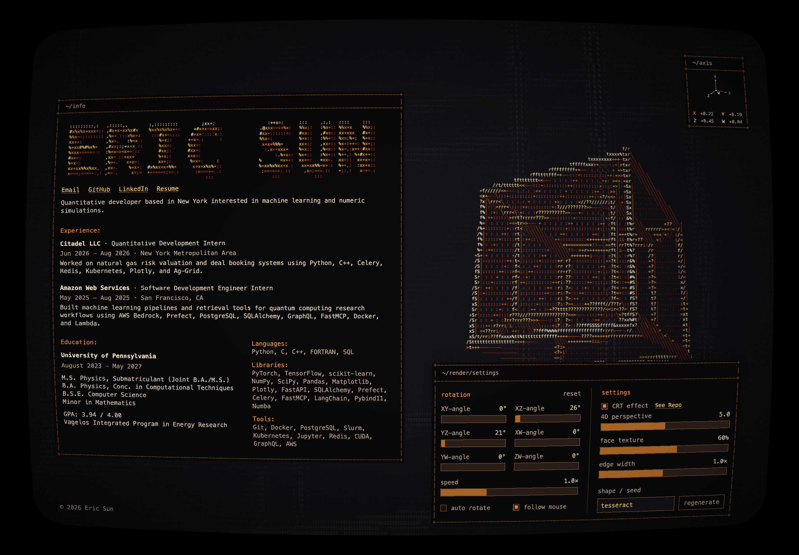

# crt-effect

Dependency-free CRT effects for live HTML and canvas: curvature, grain, scanlines, phosphor masking, vignette and glow. ES modules and TypeScript declarations ship in `dist/`.



```js
import { createCRT, createWebGLCRT } from './dist/crt-effect.js';

const crt = createCRT(document.documentElement, {
  preset: 'balanced', protect: '[data-crt-protect]',
});
crt.update({ grain: .02 });
crt.setEnabled(false);
crt.refresh();
crt.destroy();
```

Balanced defaults: `curvature: .035`, `grain: .025`, `grainFPS: 12`, `scanlines: .10`, `scanlineSpacing: 3`, `mask: .025`, `vignette: .45`, `glow: .08`. Strengths accept 0–1, curvature 0–.15, grainFPS 1–60, spacing 1–12 CSS pixels. Invalid values throw; numeric values are clamped.

## GPU canvas mode

```js
const gpu = createWebGLCRT(screen, {
  sources: [backgroundCanvas, artworkCanvas], // back to front
  aperture: true,                           // optional shared screen mask
});
// After drawing your canvases:
gpu.render();
```

WebGL 2 falls back to WebGL 1. Source canvases remain available for native interaction; disabling, context loss or teardown restores their visibility. Output defaults to at most 2× density and 3 million pixels (`pixelRatio`, `maxPixels`). `renderer` and `contextLost` expose status. `sources`, resolution and aperture are construction options.

Browsers cannot sample arbitrary live HTML directly in WebGL. Keep semantic HTML above the GPU output and give its SVG filters **one shared viewport**, using the same curvature as the GPU:

```js
createCRT(panel, {
  viewport: screen, curvature: .035, alignControls: false,
  protect: '', grain: 0, scanlines: 0, mask: 0, vignette: 0, glow: 0,
});
```

This crops a screen-wide field to each surface; panels never acquire separate curvature centers. Refresh follows scrolling, layout changes and transitions.

## Interaction and lifecycle

Text stays selectable; scrolling and keyboard controls remain native. SVG displacement changes pixels without moving hit regions. By default, controls receive counter-offsets; `data-crt-align` groups a row. `protect` tapers displacement around larger regions. `alignControls: false` curves controls with the picture, so use gentle curvature and generous targets.

Reduced motion freezes grain; hidden tabs suspend work. `destroy()` removes generated elements, observers, animation jobs and GPU resources, restoring original inline styles. Existing filters are composed. Root SVG curvature works in Chromium/WebKit; Firefox requires a non-root surface ([Mozilla limitation](https://bugzilla.mozilla.org/show_bug.cgi?id=1769223)). GPU mode works across all three engines. Safari 26 can bypass ancestor SVG filters on composited children; render canvas graphics through WebGL, avoid CSS animation inside filtered HTML, and share a viewport across native surfaces. CSP must permit generated `data:` images and inline styles.

## Development

```sh
npm install
npm run build
npm run demo        # localhost:8788; /demo/webgl.html for GPU mode
npm test
npx playwright install chromium firefox webkit
npm run test:browser
```

See [validation notes](VALIDATION.md). MIT licensed. Independently inspired by the geometry, beam and phosphor principles in [CRT-Geom](https://github.com/libretro/slang-shaders/blob/master/crt/shaders/crt-geom.slang) (cgwg, Themaister, DOLLS) and the softer aesthetic of [NewPixie](https://github.com/libretro/slang-shaders/blob/master/crt/shaders/newpixie/newpixie-crt.slang) (Mattias Gustavsson and contributors). No shader source is copied.
